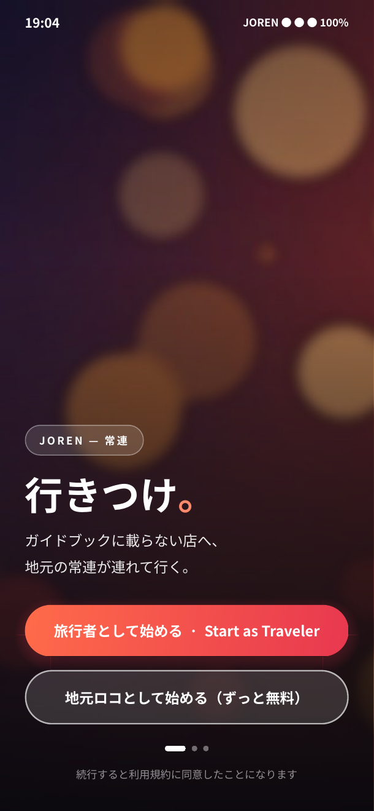
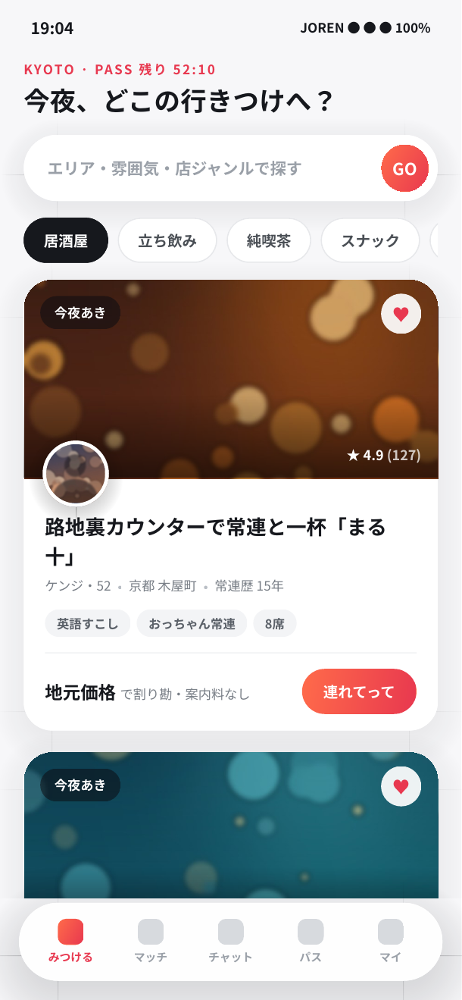
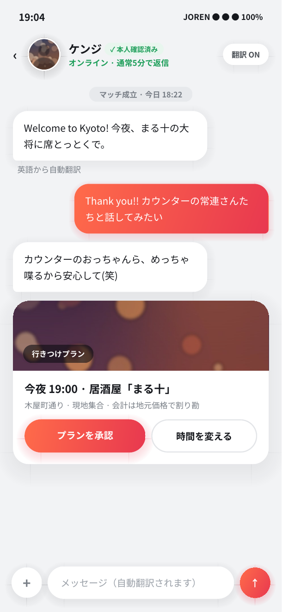
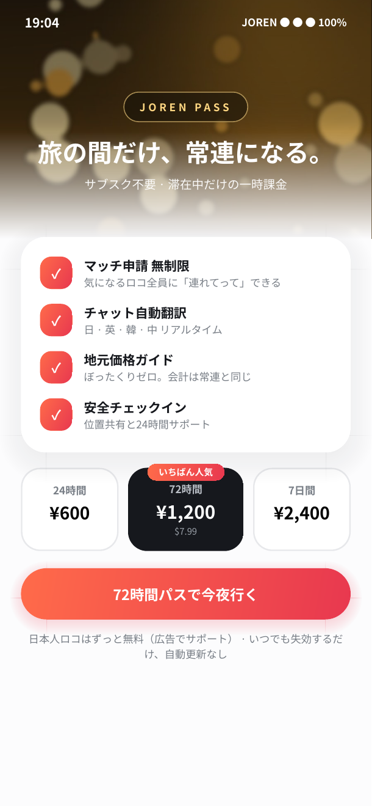
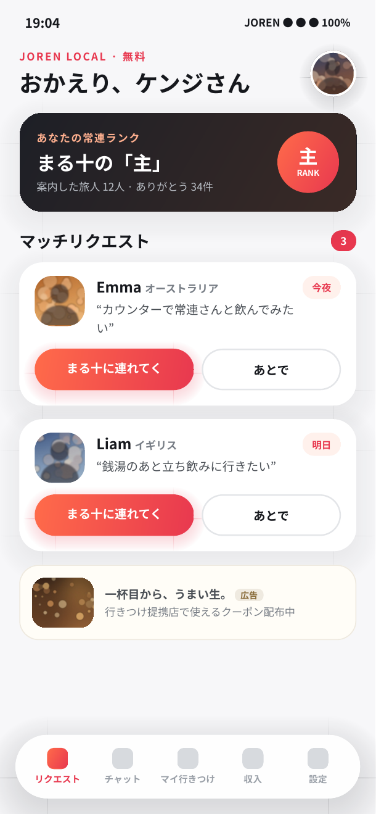
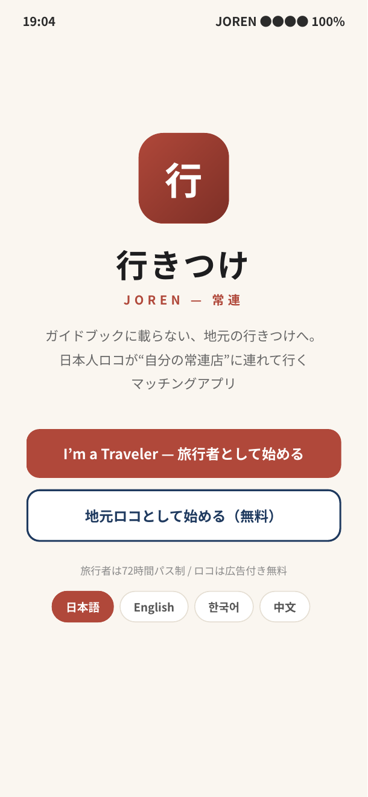
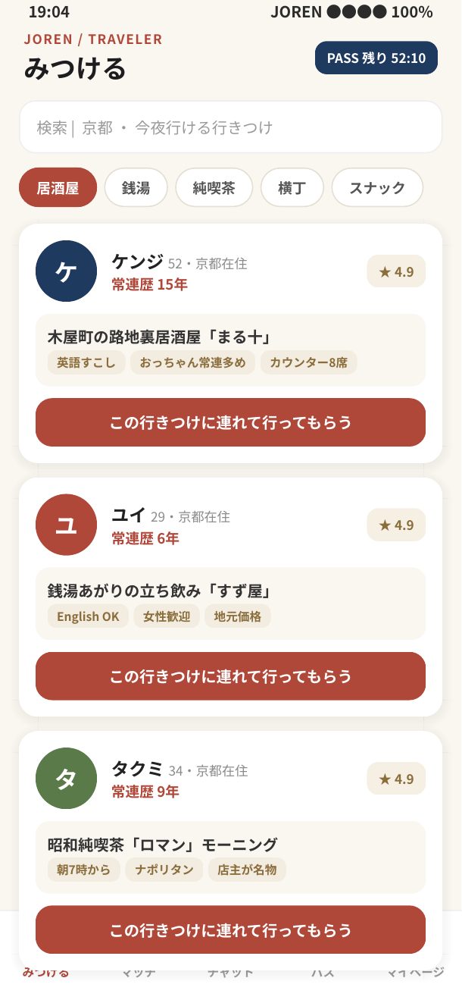
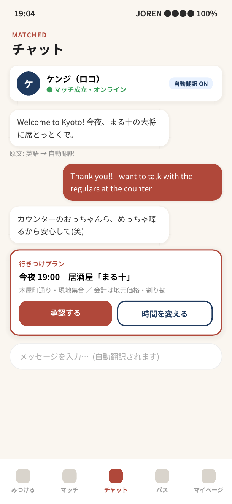
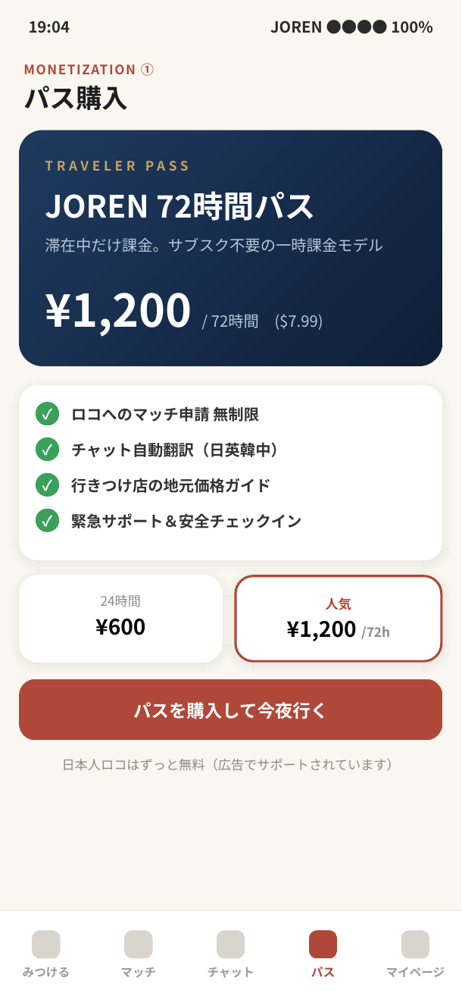
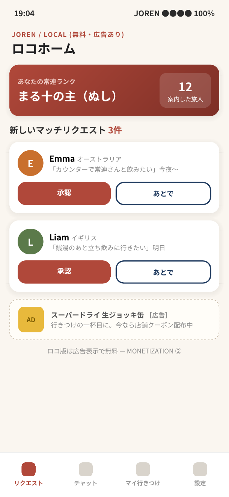

# 行きつけ（JOREN）— App UI Mock

日本人ロコと外国人観光客をマッチングするアプリ「行きつけ（JOREN / 常連）」のUIモックです。
2026-09-12 のブレインストーミング議事録をもとに作成しました。

## コンセプト

ガイドブックに載らない店へ、地元の常連（ロコ）が旅行者を連れて行く。
旅行サイトでは得られない「地元ならではの情報・体験」を提供します。

- **対象ユーザー**: 外国人観光客（Traveler）× 日本人ロコ（Local）
- **コア体験**: ロコが自分の「行きつけの店」に旅行者を案内する
- **収益化（二重構造）**:
  1. 旅行者からの一時課金（サブスク不要の滞在中パス: 24h / 72h / 7日）
  2. 日本人ロコ側は無料+広告表示

## ファイル構成

- `yukitsuke_joren_mock_v2.html` — 最新モック（v2・単一ファイル自己完結、画面切替ナビ付き）。ブラウザで開くだけで動きます
- `yukitsuke_joren_mock.html` — 初版モック（v1）
- `joren_v2_0*.png` — v2 各画面スクリーンショット
- `joren_mock_0*.png` — v1 各画面スクリーンショット

写真はすべてプログラム生成のボケ写真風プレースホルダです（実在アプリのブランド要素・実写画像は不使用）。

## 画面一覧（v2）

### 1. ようこそ / ロール選択
フルブリード背景+グラデーションオーバーレイ。旅行者/ロコのロール選択。

### 2. 旅行者ホーム（行きつけ発見）
写真主体の体験カード。ホストのプロフィール・常連歴・評価・タグ、「連れてって」CTA。パス残り時間表示。

### 3. マッチ後チャット（自動翻訳）
日英自動翻訳付きチャット。店写真サムネ入り「行きつけプラン」カードで待ち合わせを確定。

### 4. パス購入（収益化①: 旅行者の一時課金）
72時間パス ¥1,200 を中心とした3段階料金。自動更新なしの滞在中課金モデル。

### 5. ロコホーム（収益化②: 広告つき無料）
常連ランク、旅行者からのマッチリクエスト一覧、ネイティブ広告カード。

## v1 スクリーンショット

| | | |
|---|---|---|
|  |  |  |
|  |  | |
